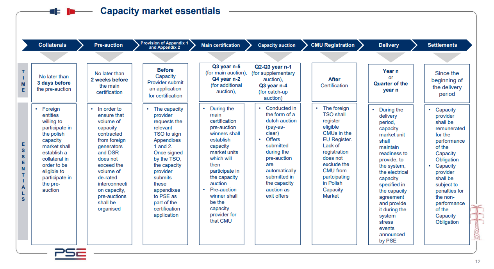

# Polish Capacity Market Deep Dive

Understand the capacity-market certification process, auction mechanics, price-maker classification and contract duration for a new generating unit.

## Resources
[PSE — Capacity Market Rules and legal framework:](https://www.pse.pl/web/pse-eng/areas-of-activity/capacity-market/legal-aspects) governing rules, auction parameters and relevant legislation.

[PSE — Capacity Market essentials:](https://www.pse.pl/web/pse-eng/areas-of-activity/capacity-market/essentials) certification manuals, auction participation and settlement guidance.

[PSE — Capacity Market FAQ:](https://www.pse.pl/web/pse-eng/areas-of-activity/faq-capacity-market) practical explanations of capacity-market units, certification and collateral.

[PSE — Capacity Market auction news and results:](https://www.pse.pl/web/pse-eng/areas-of-activity/capacity-market/capacity-market-news) current auction announcements and results.

## Capacity Market Essentials

## Summary

1. Register the unit in general certification (January to March).
2. Certify for the main auction (about 14 to 4 weeks before it) as a new generating unit with a price-maker status.
3. Provide collateral to receive the certificate for a new unit.
4. Bid in the main auction, held in December, five years before delivery.
5. Sign the capacity agreement, concluded when provisional results are published.
6. Build and prove readiness: the operational milestone (Article 52(2)) must be met or penalties and unpaid remuneration follow.
7. Deliver: be available, respond to stress events, and demonstrate capacity each quarter.

## CM Stages
[Source: 2017 Capacity Market Act](https://www.pse.pl/documents/31287/20965895/09.06.2026_The+Act+of+8+December+2017+on+the+Capacity+Market.pdf/4c7d0397-0dc5-467c-bee3-e24e7330a88a) 

### 0. What counts as a unit (Articles 2, 16)
* A physical unit is a separate set of equipment with its own metering points. A capacity market unit (CMU) is the unit, or group of units, certified to take part in auctions.
* A CMU can be a single physical generating unit of at least 2 MW, or a group of units totalling 2 to 50 MW, where no single unit exceeds 10 MW (Article 16(1)).
* The Act's wording on new-build status refers to a CMU "comprising only a single physical unit" that was planned (Article 19(2); Article 25(1)(2)). My reading is that a portfolio of engine sites grouped into one CMU would be classed as existing, not new, and would not get a multi-year contract. Confirm this with PSE.
One physical unit can belong to only one CMU in a calendar year (Article 17).

### 1. General Certification

* Runs every year, starting no later than the 2nd week and ending no later than the 11th week (Article 3(2)).
* The owner (or an authorised entity) submits a registration application with: identity details, location, technical parameters and the list of metering points (Article 12(2)). Planned units can register.
* An entry in the register entitles the unit to take part in that year's certification for the main auction (Article 12(6)).

### 2. Certification for the Main Auction (Articles 3, 15 to 26)
* Window: starts 14 weeks before the main auction and ends no later than the 4th week before it (Article 3(3)).
* Basic conditions:
    * Offer capacity of at least 2 MW (Article 16).
    * The unit must meet the emission limit of 550 g CO2/kWh in the delivery year (Articles 2(17b), 15(6)).
    * A unit commissioned after 4 July 2019 that cannot meet the limit cannot be certified (Article 16(2)(4a)).
* Maximum you can offer: net attainable capacity multiplied by the de-rating factor for your technology group (Articles 18, 19(1)(1)). The factor is set annually between 0 and 1 using five years of data. The value for gas engines comes from the auction regulation, which lists a de rating factor of ~90% for open cycle gas turbines.

* Application contents (Article 19(1)):
    * the capacity obligation offered
    * a certificate from the transmission or distribution operator confirming the metering requirements
    * copies of generation licences, or licence promises, where the Energy Law requires them
    * net attainable capacity of each unit
    * proof the units can deliver full output for at least 4 hours continuously, including how fuel availability is ensured
    * the unit carbon dioxide emission rate
    * limits on operating time from other regulations
    * declarations on the emission limit, on the commercial production date and on state aid
* Extra items for a new unit (Article 19(2)):
    * planned or spent expenditure and the scope of work
    * for contracts longer than one year, an independent study confirming the spending and the planned compliance with industrial or medium-combustion-plant emission rules and with the emission limit
    * the grid connection agreement or connection conditions, plus the final building permit and environmental decision where required and issued
    * proof of ability to obtain financing
    * a project schedule
    * the number of years of contract sought
* Exclusions (Article 16(2)): a physical unit cannot be in a CMU if, in that delivery year, it gets renewable-support balancing rights, applies for renewable guarantees of origin, gets offshore wind balancing rights, or provides a service to the transmission operator that is similar to the capacity obligation.
* Cogeneration: units generating more than 30% of annual electricity from cogeneration can take part, with the obligation capped at net capacity multiplied by the de-rating factor (Article 15(5)).
* Outcome: PSE issues a certificate (Articles 23 to 24) stating the unit's status (price-maker or price-taker), the offered obligation and the intended number of delivery periods. A new unit first receives a provisional certificate, which lets it bid once collateral is posted (Article 26).

### 3. Collateral (Articles 26, 47, 50)
* New units must post collateral to turn the provisional certificate into the right to bid. If it is not posted by the deadline in the regulation, the unit loses the right to bid (Article 26(2)).
* The operator keeps the collateral as a penalty if the agreement is terminated for failing the milestone requirement (Article 47(1)).
* The collateral rate for new units is in the Minister's regulation under Article 51, which I haven't found. Do not use the PLN 43/kW figure: that was the foreign-unit pre-auction collateral.

### 4. Collateral return 
* Collateral shall be returned after successful certification

### 5. Capacity Auction (Articles 29 to 39)
* Timing: the operator announces dates by 1 March. The main auction falls between 1 and 22 December, five years before delivery (Article 29). The Act's schedule runs to the 2025 auction for delivery in 2030, so confirm the date of the next one with PSE.
* Parameters: the minister sets them by regulation at least 18 weeks before the main auction (Article 34). They include the demand curve, the maximum price for price-takers, the capital-expenditure thresholds, the de-rating factors and the number of rounds (Article 32).
* Mechanism: a multi-round descending-price auction. A bidder either submits an exit bid or is treated as accepting the next round's starting price (Article 30). Price-makers can exit at any price up to the maximum auction price. Price-takers can exit only up to their ceiling (Article 30(5)).
* Ending and price: the auction ends when the volume that has not exited is no more than demand, or after the last round. The clearing price is the highest price at which a winning obligation was offered (Article 36). Winners in a tie are ranked by lower emissions, then by time of the bid.
* Shortening: in the main auction a multi-year bidder can switch once to a one-year obligation at the multi-year minimum price (Article 30(7)).
* Results: provisional results are published within 3 working days (Article 38). The regulator publishes final results on the first working day after the 21st day (Article 39). The minister or the regulator may annul the auction within 14 days.

### 6. Capacity Agreement (Articles 41 to 47b)
* Concluded electronically at the time provisional results are announced, subject to final results (Articles 44 to 45).
* Remuneration is due from the start of each delivery period. For a new unit it is conditional on proving the milestone requirements in Article 52 (Article 44(5)).
* Delay penalties for a new unit that has not met Article 52(2): each month of the delivery year costs 5% (year one), 15% (year two) or 25% (year three) of the monthly value of the obligation, priced at the highest clearing price for that year (Article 47(2)). My example: a 9 MW obligation at PLN 465/kW/year is about PLN 349,000 a month, so 5% is about PLN 17,000 a month, on top of unpaid remuneration.
* Termination if the first milestone (Article 52(1)) is missed, or if Article 52(2) is not met by the end of the third delivery year (Article 46).
* Real-world cost of delay: Energa reported that missing the operational milestone at two gas plants meant the loss of capacity revenue of about PLN 23 million and PLN 17 million a month (Bankier / Energa filing).
* Flexibility: if net capacity changes by 5% or less, you may ask once to adjust the obligation (Article 47a). If a new unit will not meet the emission limit, it can swap into a replacement agreement under strict conditions (Article 47b)

### 7. Secondary Market (Article 48)
* After the additional auctions, an obligation can be transferred to another unit for all or part of the delivery period (only the future part). Transactions must be filed at least 24 hours before they start.
* After a stress event, spare performance by one unit can cover another unit's shortfall. File within working days 1 to 5 after the final settlement.
* Blocked cases include units with unpaid penalties, failed demand-response or stress tests, a new unit that has not met Article 52(2), and units without an emission-limit declaration.

### 8. Performing the obligation

The Act defines a stress event as a full hour when surplus capacity is below the required level (Article 2(26)).

* Stress events: full hours between 07:00 and 22:00 on working days, announced at least 8 hours ahead.
* Test events: up to once a quarter, 8 hours' notice, judged on metered output only.
* Quarterly demonstration: at least one working-day hour at your highest obligation, or the quarter's remuneration is refunded.
* Penalty: unit rate multiplied by undelivered capacity (Section 17.2.2 of the Rules).